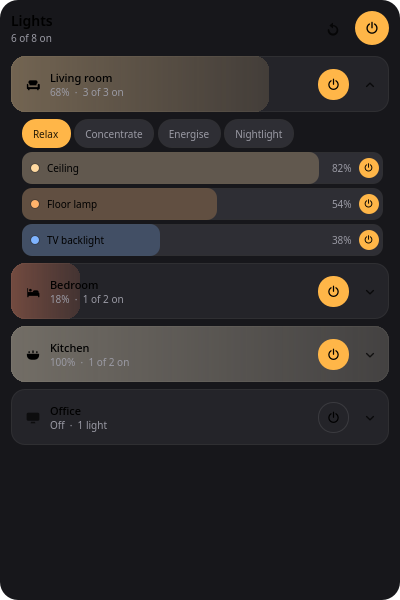
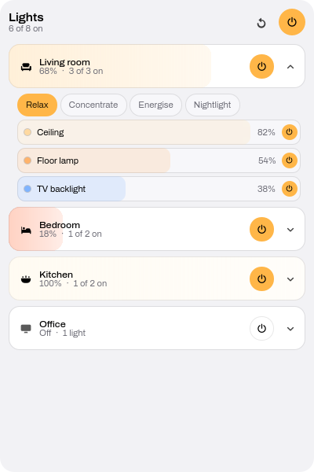
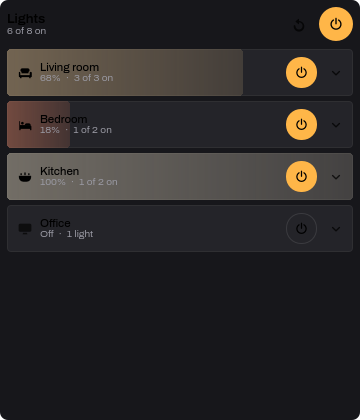
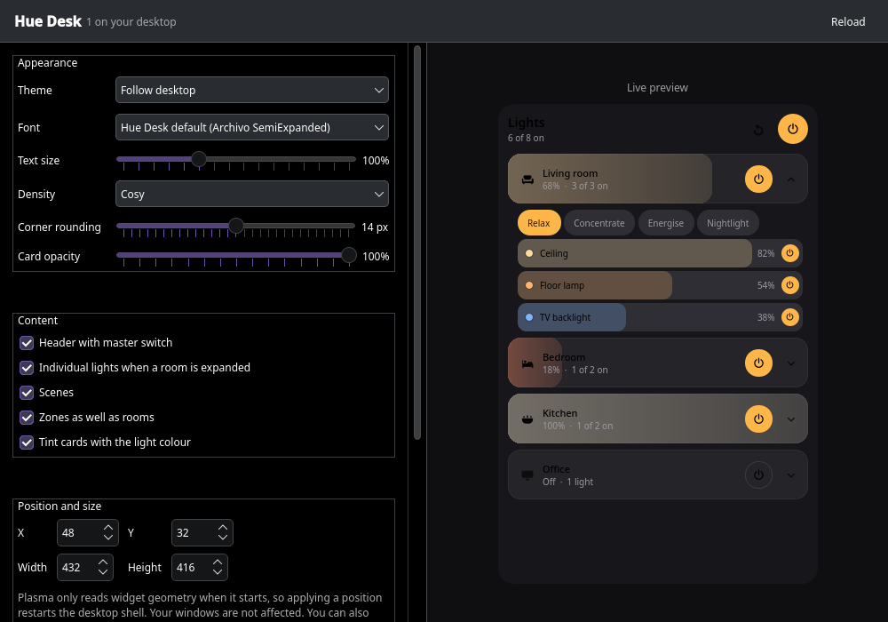

# Hue Desk

[](https://github.com/robertjanvlak111/huedesk/actions/workflows/ci.yml)
[](LICENSE)
[](https://kde.org/plasma-desktop/)
[](https://ko-fi.com/robertjanvlak)

A Philips Hue widget that lives on your KDE Plasma desktop, styled after the
Hue app rather than a settings dialog. Rooms are brightness bars you drag,
scenes sit in a carousel, and everything is always visible — no tray icon, no
pop-up.



| Dark | Light | Compact |
| --- | --- | --- |
|  |  |  |

**Using a card:** click anywhere on it to set that brightness, or drag across
it to scrub. Dragging up or down still scrolls the list. Ctrl+scroll nudges a
level by 5%. Power and expand are separate buttons, so a click is never
ambiguous.

It talks to your bridge directly over your own network. Nothing leaves your
LAN, and there is no account, cloud service or telemetry.

## Requirements

| | |
| --- | --- |
| **Desktop** | KDE Plasma **6** (Wayland or X11). Not Plasma 5, GNOME or anything else. |
| **Bridge** | A **square** Philips Hue Bridge (v2, model BSB002) on the same network, firmware 1948086000 or newer. The round first-generation bridge does not speak the v2 API and will not work. |
| **`curl`** | Used for every bridge request. Installed by default nearly everywhere. |
| **PySide6** | Only for the settings app. The widget itself works without it. |
| **Pillow** | Only to run the visual tests. Not needed to use Hue Desk. |

Check your Plasma version and bridge in one go:

```bash
plasmashell --version
curl -s https://discovery.meethue.com/
```

The second command prints your bridge's address, which is handy later.

## Install

> A KDE Store listing is planned, which will make Hue Desk installable from
> **Add Widgets… → Get New Widgets…**. Until then, use the clone below.
> Maintainers: see [docs/PUBLISHING.md](docs/PUBLISHING.md).

```bash
git clone https://github.com/robertjanvlak111/huedesk.git
cd huedesk
./install.sh
```

The installer checks your system first and refuses rather than half-installing
if something is missing. It needs **no root** and writes only inside your home
directory:

| Path | What |
| --- | --- |
| `~/.local/share/plasma/plasmoids/com.rvlak.huedesk/` | the widget |
| `~/.local/share/huedesk/` | the settings app |
| `~/.local/bin/huedesk-settings` | launcher |
| `~/.local/share/applications/` | its menu entry |

It restarts Plasma at the end so the widget appears in the widget list. Your
open windows are not affected.

If PySide6 is missing the widget still installs and only the settings app is
skipped. To add it:

| Distribution | Command |
| --- | --- |
| Fedora, Bazzite, Nobara | `sudo dnf install python3-pyside6` |
| Arch, EndeavourOS | `sudo pacman -S pyside6` |
| Debian, Ubuntu, KDE neon | `sudo apt install python3-pyside6` |
| openSUSE | `sudo zypper install python3-pyside6` |

### Add it to your desktop

1. Right-click your desktop → **Add Widgets…**
2. Search for **Hue** — the entry is called *Hue Desk* — and drag it onto the desktop
3. Press the round button on top of your bridge
4. Choose **Pair** in the widget

Pairing is a one-time step. The bridge only issues a key for about 30 seconds
after that button is pressed, which is how it knows you are physically there.
If you miss the window, press it and choose Pair again.

> Searching `huedesk` as one word finds nothing — the widget is named
> "Hue Desk". If it is not listed at all, Plasma has not rescanned yet:
> `kquitapp6 plasmashell && kstart plasmashell`

### Installing from a downloaded file

Releases also attach a `.plasmoid` file, which is the same thing the KDE Store
serves. Note that double-clicking it does **not** work: Plasma registers the
file type but ships no application that handles it, so your file manager will
only offer to open it with something. Install it from a terminal:

```bash
kpackagetool6 --type Plasma/Applet --install com.rvlak.huedesk-<version>.plasmoid
```

To update a widget installed this way, use `--upgrade` instead; `--install`
refuses when the widget is already present:

```bash
kpackagetool6 --type Plasma/Applet --upgrade com.rvlak.huedesk-<version>.plasmoid
```

Then restart the shell so Plasma picks up the new version:
`kquitapp6 plasmashell && kstart plasmashell`

### Uninstall

```bash
./uninstall.sh
```

Then right-click the widget on your desktop and choose Remove.

## Settings

Launch **Hue Desk Settings** from your application menu, or run
`huedesk-settings`. Changes apply to the running widget as you make them, and
the preview on the right is the real widget, loaded from the installed files.



| | |
| --- | --- |
| **Theme** | Light, dark, or follow the desktop |
| **Font and text size** | Archivo SemiExpanded by default, or any installed family, 75–150% |
| **Density** | Compact, cosy or comfortable spacing |
| **Corner rounding, card opacity** | Match your desktop's look |
| **Content** | Show or hide the header, individual lights, scenes, zones |
| **Position and size** | Exact coordinates, or just drag the widget |
| **Bridge** | Address and how often to poll |

Everything is also in Plasma's own dialog: right-click the widget →
**Configure Hue Desk**.

> Moving the widget from the settings app restarts Plasma's desktop shell,
> because Plasma only reads widget geometry at start-up. Your open windows are
> unaffected. Dragging the widget on the desktop avoids the restart.

## How it works

Hue Desk uses the bridge's **CLIP v2** API over HTTPS. Bridges use a
self-signed certificate, which QML's `XMLHttpRequest` rejects outright, so
requests are made with `curl` through Plasma's executable data engine. One
batched call per poll fetches rooms, zones, grouped lights, lights and scenes.

Pairing is the single exception: it uses the older v1 endpoint over plain
HTTP, which is the only way a bridge will issue an application key.

```
package/contents/
  code/HueBridge.qml    transport, pairing, commands
  code/HueModel.js      CLIP v2 resources -> view model   (pure, tested)
  code/HueColors.js     xy / mirek -> RGB                 (pure, tested)
  ui/Theme.qml          every colour, metric and font
  ui/RoomCard.qml       a room as a brightness bar
```

More detail in [docs/ARCHITECTURE.md](docs/ARCHITECTURE.md).

## Tests

```bash
python3 tests/run_tests.py
```

The pure logic lives in plain `.js` files that QML imports directly, and the
tests run those exact files in Qt's JavaScript engine — not a reimplementation
of them. Only PySide6 is needed.

The suite also renders the widget offscreen and checks two things a
screenshot cannot:

- **Contrast** — every label is measured against its own background and must
  clear the WCAG AA 4.5:1 bar in both themes. A card's background is whatever
  colour the bulbs are, so no fixed palette can guarantee this.
- **Dragging** — a real drag is driven across a card with synthetic mouse
  events, asserting the delegate survives the gesture and the level tracks the
  pointer. Writing to the model mid-drag destroys the card and silently turns
  dragging back into clicking, which this catches.

Both need a Plasma 6 desktop (for its QML modules) and Pillow. They skip
themselves with a clear message anywhere else, such as a CI runner, where only
the unit tests run.

## Troubleshooting

**The widget is not in "Add Widgets".** Plasma caches that list. Restart the
shell: `kquitapp6 plasmashell && kstart plasmashell`. Search for `Hue`, not
`huedesk`.

**"Press the round button on your bridge, then try again."** The bridge only
issues a key for about 30 seconds after the button is pressed. Press it and
choose Pair again.

**"Cannot reach the bridge."** Check the address in the settings app. Find it
with `curl -s https://discovery.meethue.com/`.

More in [docs/TROUBLESHOOTING.md](docs/TROUBLESHOOTING.md).

## A note on the application key

Your bridge key is stored in Plasma's applet configuration
(`~/.config/plasma-org.kde.plasma.desktop-appletsrc`) in plain text, the same
as any other Plasma widget's settings. It only grants control of lights on
your own network, but it is not secret storage. Do not paste that file into a
bug report.

## Support

Hue Desk is free and always will be. If it has been useful, you can
[buy me a coffee](https://ko-fi.com/robertjanvlak).

The widget asks about this exactly once, after about three months of use, and
says so when it does. It never asks again, whether or not you act on it.
Nothing is sent anywhere — the date of first use is a line in your own Plasma
config, and the check happens entirely on your machine.

## Contributing

See [CONTRIBUTING.md](CONTRIBUTING.md). Bug reports and patches are welcome.

## Typography

Hue Desk ships with **Archivo SemiExpanded** by Omnibus-Type, under the
[SIL Open Font License 1.1](package/contents/fonts/OFL.txt). It is a grotesque
drawn for legibility at interface sizes, and its semi-expanded width gives the
open, airy feel of the Hue app.

The font is bundled rather than merely requested, so the widget looks the same
on every machine. Pick any installed family instead in the settings app.

## License

Hue Desk is [MIT](LICENSE). The bundled font is SIL OFL 1.1 and keeps its own
[licence file](package/contents/fonts/OFL.txt).

Not affiliated with, endorsed by, or connected to Signify or Philips. "Philips
Hue" is their trademark; this is an independent project that talks to the
bridge's documented local API.
